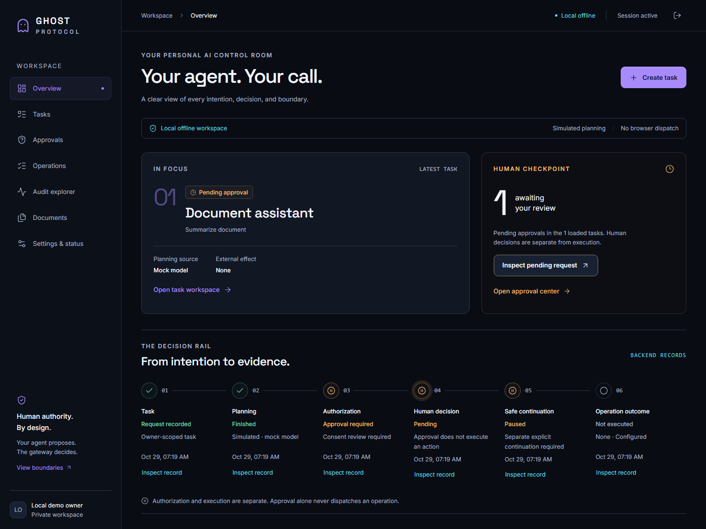
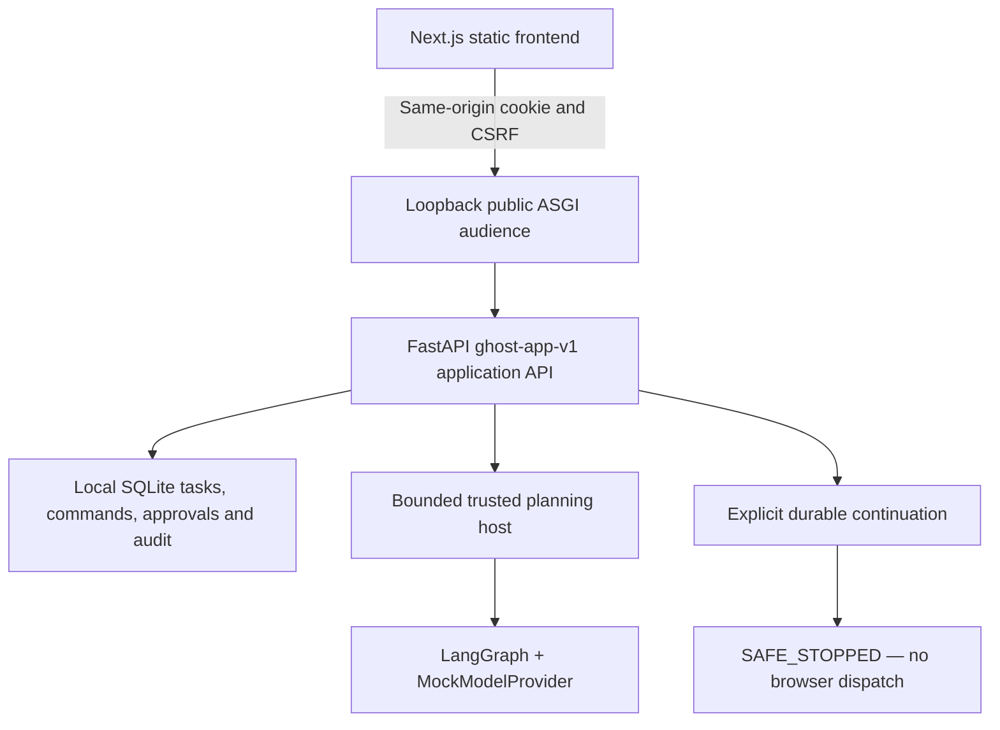

# Ghost Protocol

**Personal AI. Human authority.** A local control room that makes an agent’s proposal, authorization decision, human approval, safe continuation and recorded outcome separately inspectable.

Built for the Nebius × NVIDIA Global AI Hackathon. The accepted product is a **Windows local offline demonstration** with simulated planning and genuine persisted application records. A separate [public interactive synthetic demo](public-demo/README.md) is implemented for hosting review; its public URL has not been created. Neither mode claims production hosting, live inference through the application, protected browser execution or native sandbox enforcement.

## What works

- Browser-safe local pairing, HttpOnly sessions, CSRF and strict same-origin access.
- Durable scoped task creation, bounded LangGraph planning with a deterministic mock model, and a six-stage Decision Rail derived from real records.
- Exact human approval inspection, approve/reject/revoke, expiry handling and separately initiated continuation.
- Genuine **SAFE_STOPPED** outcomes: backend workflow `RESUMED` does **not** mean protected execution. Operations remain `NOT_EXECUTED` in the browser workflow.
- Owner-scoped document catalog metadata, operation history, chronological audit pages and copyable safe references.
- Explicit cancellation of future task authority, session/capability status, accessible confirmations and responsive navigation.

The catalog exposes six metadata fields, never raw contents. Dashboard and approval summaries cover their loaded task pages. Operation pages organize the bounded returned set; only tasks, documents and audit expose backend cursors. No fake production metrics or successful external execution is displayed.

## Frontend screenshots



[Mobile overview](docs/assets/frontend/dashboard-mobile.png) · [Exact approval confirmation](docs/assets/frontend/approval-mobile.png) · [SAFE_STOPPED outcome](docs/assets/frontend/safe-stopped-desktop.png)

These are existing synthetic local-backend screenshots. Planning is simulated; approval and continuation never imply protected execution. Personal filesystem paths and private operator codes are not part of these curated images.

## Architecture



`frontend/scripts/serve.py` composes the static export around the unchanged public application on one literal-loopback listener. It is not an API proxy. Trusted gateway/execution interfaces remain outside the browser audience; the deterministic gateway owns sensitive authorization and execution. The model can propose intentions, never grant itself authority.

| Area | Location |
| --- | --- |
| Next.js / TypeScript control room | [`frontend/`](frontend/README.md) |
| Isolated browser-only synthetic public demo | [`public-demo/`](public-demo/README.md) |
| FastAPI application, sessions and deterministic gateway | `member_a_backend/nvidia backend/app/` |
| Agent, model adapter, memory and skills | `backend/app/` |
| Accepted browser contract | [`ghost-app-v1.openapi.json`](docs/frontend-handoff/generated/ghost-app-v1.openapi.json) |
| Synthetic fixtures | [`fixtures/ghost_demo/`](fixtures/ghost_demo/README.md) |
| Current publication review and exact source inventory | [Phase 5D-R1 release review](docs/release/PHASE5D_R1_FINAL_RELEASE_APPROVAL.md) · [current staging manifest](docs/release/PHASE5D_STAGING_MANIFEST.md) |

The repository contains earlier architectural drafts and historical backend setup instructions. The accepted local setup below and generated application contract govern this frontend; older Docker/private-bearer examples are not the browser startup path.

## Nebius Token Factory and NVIDIA Nemotron

The Member B adapter implements typed, bounded requests for configured NVIDIA Nemotron model identifiers through Nebius Token Factory. It validates endpoint/settings/output, bounds retries and timeouts, and redacts credentials from telemetry. Real credentials belong only in the trusted operator environment; no key is embedded in the UI or supplied to an untrusted sandbox.

Earlier isolated live-model probes are historical evidence, separate from application acceptance. **The accepted application profile uses `MockModelProvider`; it makes no paid inference calls.** An example configuration file is a template, not proof of model availability. Exact provider/model configuration and any future paid validation require separate operator approval. No model weights or provider redistribution permissions are supplied by this repository.

## OpenShell status

OpenShell integration adapters and Windows/native contract tests are retained in the source. They do not establish native sandbox admission, isolated LangGraph execution or end-to-end enforcement. Raw host evidence under `docs/openshell/` stays in the private workspace and is excluded from the publication snapshot. The existing `DEFER_LIVE_SANDBOX` boundary remains in force. OpenShell and Docker are unnecessary for the qualified offline application and must not be started as part of its setup.

## Local setup

Qualified setup: **Windows x64 on a fixed local drive**, CPython **3.11.18** for Member B and **3.14.10** for Member A, Node **24.16.0**, npm **11.13.0**, and uv **0.13.6**. Install the prerequisites from their official distributions. `.node-version` records the Node version. The two Python environments deliberately keep their separate `app` namespaces.

Fresh installation, from a new checkout with neither `.venv` directory present:

```powershell
uv python install 3.11.18 3.14.10 --no-bin --no-registry
uv venv --python 3.11.18 .venv
uv pip sync --python .venv/Scripts/python.exe --require-hashes --only-binary=:all: --default-index https://pypi.org/simple requirements/member-b-windows-py311.lock.txt
uv venv --python 3.14.10 'member_a_backend/nvidia backend/.venv'
uv pip sync --python 'member_a_backend/nvidia backend/.venv/Scripts/python.exe' --require-hashes --only-binary=:all: --default-index https://pypi.org/simple requirements/member-a-windows-py314.lock.txt
```

These hash-locked environments and a clean `npm ci` installation were actually tested. Do not overwrite an existing environment; use a separate checkout for the fresh-install commands. [Dependency reproducibility](docs/release/DEPENDENCY_REPRODUCIBILITY.md) records exact tested patch versions, lock provenance, advisory results and regeneration commands. Other operating systems/Python combinations are not qualified by these Windows locks.

The offline application needs **no provider key, `.env`, MySQL server, Docker or OpenShell**. Network access is needed to obtain dependencies; the application/test workflow then runs offline. The optional private provider adapter uses the variable names in `.env.example`, with an explicitly verified Nemotron model identifier. Do not copy real secrets into source, frontend assets or public preview code. Optional MySQL dependencies remain in Member A's manifest; production migration/concurrency testing is a separate gate.

Run from the repository root in a **private interactive PowerShell terminal**. Port 3000 must be free.

```powershell
Push-Location frontend
npm ci
npm run generate:api
npm run build
Pop-Location

$demoDirectory = Join-Path ([IO.Path]::GetTempPath()) ("ghost-offline-demo-" + [guid]::NewGuid())
Push-Location 'member_a_backend/nvidia backend'
.venv/Scripts/python.exe -B -m app.offline_demo init --offline --directory "$demoDirectory"
.venv/Scripts/python.exe -B -m app.offline_demo verify --offline --directory "$demoDirectory"
Pop-Location

& 'member_a_backend/nvidia backend/.venv/Scripts/python.exe' -B frontend/scripts/serve.py --directory "$demoDirectory" --pair
```

Open **http://127.0.0.1:3000** and enter the terminal’s one-use code within 120 seconds. Keep the code private. Pairing is disabled without `--pair`; there is no browser endpoint that issues codes. Do not substitute a hostname, bind publicly, add a reverse proxy or use a tunnel to bypass the accepted Host/Origin controls.

Create a **Document assistant** task with a listed synthetic resource. Enter `Summarize this synthetic document, but never share the original.` Start simulated planning, inspect the exact pending approval, approve deliberately, and request continuation separately. Inspect SAFE_STOPPED, operation provenance and audit history. This creates a simulated plan; it does not read or summarize protected document contents.

Stop with Ctrl+C. Restart the last command with the same `$demoDirectory` to retain durable records, then pair again. To reset, initialize another unique directory; never overwrite or automatically delete prior state. The approved initializer creates an ORM snapshot, not a production MySQL migration.

`npm run dev` binds the styling-only Next.js server to `127.0.0.1:3001`. Connected acceptance uses the production build and single ASGI listener above.

## Testing

Frontend, from `frontend/`:

```powershell
npm run generate:api
npm run typecheck
npm run lint
npm test
npm run build
npx playwright install chromium firefox webkit
npx playwright test --browser=all
npm audit
```

Browser tests start their own disposable real offline backend on port 3000, refuse an occupied listener, keep transient pairing values in private pipes and disable video/traces. Fresh rerun screenshots go to temporary Phase 4 evidence folders, preserving Phases 1–3. No inference or email provider is used.

Chromium and Firefox qualify the tested local session-cookie behavior. Windows Playwright WebKit provides UI/protocol coverage only: it does not enforce Strict cookies in the isolated diagnostic. The suite explicitly annotates this limitation and verifies the server's Strict policy without weakening backend controls. This is not Safari/macOS security acceptance.

Backend and static-host checks, from the repository root:

```powershell
$env:PYTHONDONTWRITEBYTECODE = '1'
$env:PYTEST_DISABLE_PLUGIN_AUTOLOAD = '1'
$env:PYTHONIOENCODING = 'utf8'
.venv/Scripts/python.exe -B backend/tests/run_offline_suite.py

Push-Location 'member_a_backend/nvidia backend'
.venv/Scripts/python.exe -B tests/run_offline_suite.py tests -m 'not integration' -ra -p no:cacheprovider
.venv/Scripts/python.exe -B -m pytest ../../frontend/tests/test_static_host.py -q -p no:cacheprovider
Pop-Location

.venv/Scripts/python.exe -B tools/validate_openapi.py docs/frontend-handoff/generated/ghost-app-v1.openapi.json
.venv/Scripts/python.exe -B -m pytest tools/tests/test_prepare_publication.py -q -p no:cacheprovider
.venv/Scripts/python.exe -B -m ruff check frontend/scripts frontend/tests tools/prepare_publication.py tools/tests/test_prepare_publication.py
.venv/Scripts/python.exe -B -m ruff format --check frontend/scripts frontend/tests tools/prepare_publication.py tools/tests/test_prepare_publication.py
```

The guarded offline runners block external networking; MySQL integration cases and paid live inference are excluded deliberately. Exact clean-install results and limitations are in [the Phase 5A audit](docs/release/PHASE5A_RELEASE_AUDIT.md). Member A retains a Windows-compatible pytest pin with an advisory affecting UNIX temporary-directory handling; this is documented, not silently suppressed. No globally clean Ruff or universal vulnerability-free claim is made.

## Supported modes and security limitations

| Mode | Status |
| --- | --- |
| Local offline browser application | Accepted synthetic demonstration |
| Read-only inspection of durable owner records | Supported through the application API |
| Trusted synthetic execution/UNKNOWN regression harness | Test-only, separate from the browser; no external effect |
| Live Nemotron through the browser/application | Not qualified |
| Real document read or email dispatch from the browser | Unavailable |
| Native OpenShell enforcement, production MySQL and deployed HTTPS | Not qualified |
| Public static synthetic demo | Implemented separately; original team assets approved, deployment approval pending, public URL not created |
| Public hosting of the real backend | Blocked pending separate architecture/security acceptance |

The HTTP loopback cookie is HttpOnly/SameSite=Strict and intentionally has no Secure attribute on HTTP. This is a local exception, not a public-hosting policy. Sessions are single-process, restart-invalidated and time-bounded. Owner identity is server-derived; references grant no authority. Approval, revocation, cancellation, continuation and execution remain separate concepts. UNKNOWN outcomes require reconciliation and never automatic resend.

See the [current release approval review](docs/release/PHASE5D_R1_FINAL_RELEASE_APPROVAL.md), [Cloudflare instructions](docs/release/PHASE5D_CLOUDFLARE_DEPLOYMENT.md) and [current exact staging manifest](docs/release/PHASE5D_STAGING_MANIFEST.md). Earlier Phase 5A–C reports describe their dated snapshots and are superseded on licensing by the owner's explicit Phase 5D-R1 authorization. The default publication helper now validates the Phase 5D-R1 manifest; the Phase 5C JSON remains historical evidence. Do not publish a copy of the complete workspace: ignored local secrets, archives, environments and runtime state must stay private.

## License and release status

Original team-owned Ghost Protocol code, documentation and approved visual assets are licensed under the [MIT License](LICENSE), with **Copyright (c) 2026 Ghost Protocol Contributors**. The project owner explicitly confirmed Members A, B and C's agreement and original logo/icon/screenshot/public-demo redistribution rights in Phase 5D-R1. Third-party materials retain their own licenses; the project MIT grant does not relicense fonts, icons, dependencies, provider/model materials or sponsor marks. [Third-party attribution](docs/release/THIRD_PARTY_ATTRIBUTION.md) records their notices and scope. The earlier draft is retained only as dated review evidence.

The clean source-only staging copy is prepared for explicit publication/deployment approval. No commit, push, tag, deployment or video has been performed. Public URL: **NOT CREATED**.
