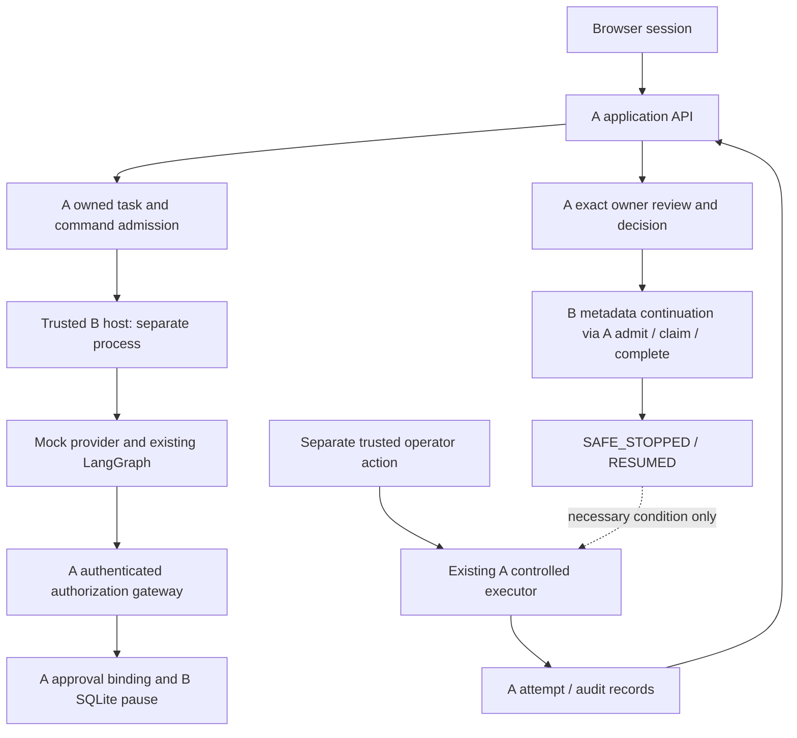

# Task, planning, approval and workflow lifecycle

Contract: **ghost-app-v1, draft 0.1.0**. Step 44A, 2026-10-28.
**PROPOSED application composition; existing underlying contracts remain unchanged.**

## 1. Authority and data ownership

| Data | Authority / persistence | Browser role |
| --- | --- | --- |
| Identity/session | New A local-demo session adapter; bounded process memory | Present opaque cookie/CSRF, never select owner |
| Task/credential/scope | Existing A GatewayTask/AgentCredential and task services | Select a fixed profile/resource, not an authorization record |
| App command / safe plan | Proposed A application_commands, additive migration | Submit one intent with command key; inspect metadata |
| Tool request/operation/approval | Existing A immutable request reconstruction, ledger, PendingApproval and scoped consent | Read exact private proposal and decide as session owner |
| Graph planning | Existing B LangGraph; prompts/candidate outputs are run-local | See typed plan metadata labelled MOCK_MODEL |
| Continuation | A WorkflowCheckpoint + B restricted official SQLite saver | Ask to continue a known owned task, never supply checkpoint identity |
| Execution | Existing A controlled dispatcher and attempt ledger | Observe only; no app dispatch route |
| UI timeline | New allowlisted projection of genuine A audit rows | Read-only; presentation never grants authority |

There is no browser-to-executor edge. Approval, continuation and dispatch remain
three separate actions. Neither a code-generated diagram nor an app DTO attests
native sandbox isolation.

## 2. Task creation

1. A04 authenticates/CSRF-checks, obtains fixed owner and validates the profile.
2. For a document profile, A lookup_resource verifies active owner-registered
   synthetic metadata; A pins the current resource/version/classification itself.
3. Reserve application command identity and create the A task in one reviewed
   transaction. This needs the transaction-compatible task service extraction
   described in [02](02_APPLICATION_API_CONTRACT.md); do not nest the current
   self-owned transaction or return an unassociated orphan as a successful task.
4. Task is OPEN with 900-second deadline, one allowed action and approval enabled.
   The browser receives TaskDetail; no consent/credential is issued by creation.

Same command/key reuses the task; changed payload conflicts. The profile ceiling
cannot be edited. Expiry is evaluated with A's trusted UTC clock; no task TTL,
purpose, owner, action, recipient or version comes from model text.

## 3. Planning and authorization admission

A07 is synchronous with a **20-second total deadline**, including host startup/
credential acquisition/graph/authorization/pause bookkeeping. The approved demo
uses only MockModelProvider: provider/graph planning bound 10 seconds, one model
invocation, no provider retry, ExecutionOptions.max_plan_actions=1 and the existing
gateway client deadline <=4 seconds. No live provider construction or `.env`
loading is permitted in the demo host. A real-provider mode is separate future
approval and may need a different timing contract.

Before calling B, reserve the durable unique planning command for this task and
issue a task credential through A's existing owner service. It stays in private
host memory; never put it in the app command result. A host failure after this
point does not authorize a second issuance/replan. Do not leave a DB transaction
open while waiting for B.

The trusted host constructs exactly one ActionBinding from the immutable profile,
catalog pin or fixed backend email template. The prompt is data. Run the existing
GatewayOrchestrator through explicit TRUSTED_AUTHORIZATION_ONLY composition,
not the permissive appearance of an arbitrary object/provenance attribute. Its
existing preflight must reject any plan with different/extra actions or mismatched
task/arguments. Map that to PLAN_OUT_OF_SCOPE and do not invent a safe replacement
plan. Proposed actions in the API are observed model output, not allowed actions.

| Observed planning/authorization outcome | App state / next action |
| --- | --- |
| No planning command | NOT_STARTED, no planning_ref; GET cannot create a command |
| Claim committed and host active | RUNNING; concurrent POST409 COMMAND_IN_PROGRESS |
| Valid clarification / unsupported output | FINISHED with actual CLARIFICATION_REQUIRED / UNSUPPORTED_OPERATION; no gateway call or effect |
| Valid matching plan, A DENY | FINISHED / PLAN_READY plus actual DENY/reason; no effect |
| Valid matching plan, A ALLOW / NOT_EXECUTED | FINISHED / PLAN_READY plus ALLOW; **stop**. ALLOW-only proposals do not obtain workflow/execution authority |
| A genuine APPROVAL_REQUIRED | Persist original reference/key metadata, invoke existing DurableApprovalWorkflow.pause, register actual SQLite checkpoint; FINISHED with pending approval and PAUSED binding |
| Definite provider/preflight/validation failure | FAILED, safe error, no fabricated proposal/decision |
| Timeout, host crash or ambiguous pause/admission acknowledgment | UNCERTAIN; inspect A's original operation/binding and retained metadata; no automatic model call, gateway re-POST, pause recreation or key regeneration |

Finished planning is not task completion. A's GatewayTask remains OPEN until
expiry/cancellation or a separately specified completion flow. B's planning
TaskStatus.COMPLETED cannot be copied into A's task authority state. No new model
call is allowed for the same task even if the first attempt failed; use explicit
review/new task for new safe work, and never to evade an unknown email effect.

## 4. Exact owner approval

A09 lists only pending approvals for one owned app task. A10 delegates exact
review to existing owner_approval, reconstructs original typed arguments from A,
and returns them privately with no-store. Render body/text as data. The browser
does not supply reviewed arguments on A11, only APPROVE or REJECT for that exact
immutable approval reference.

| Current approval | Permitted owner transition / consequence |
| --- | --- |
| PENDING | APPROVED, REJECTED, EXPIRED, REVOKED under existing A state machine |
| APPROVED | EXPIRED or REVOKED; may be consumed once at execution admission |
| REJECTED / EXPIRED / REVOKED | No reactivation, replacement grant or auto-approval |
| Same recorded owner decision | Existing idempotence, with current state projected; never repeat downstream effects |

Approval creates A's operation-bound one-use scoped consent. It does not call B
resume, consume approval.consumed_at, dispatch, send mail or rotate a credential.
Expiry/revocation/current task/credential/profile checks remain in A. A new app
error shape only projects failures; it does not turn 409 into a successful grant.

Draft and send each require their own fixed-profile operation and approval. A
draft approval cannot authorize send; a document approval cannot authorize email.
This application offers no arbitrary direct-consent grant route.

## 5. Workflow status and continuation

A13 discovers the unique A binding for the owned task/operation. It does not
accept a browser binding, thread, checkpoint, authorization version or resume
hint. Null binding means absent. continuation_available means A metadata makes a
request eligible and the configured host is available; it is an advisory UI
predicate, never proof that local checkpoint validation or later admission will
succeed. Compute it false for pending/revoked/expired approvals, inactive task or
credentials, RESUMING/DENIED/RESUMED phase, or unresolved command state.

A14 reserves the unique application continuation command for the discovered
binding, then calls the existing B DurableApprovalWorkflow.resume. B checks its
actual persisted local interrupt; A owns subsequent fresh version/expiry/consent
checks. Command identity is held outside B's metadata-only SQLite saver.

| From | Action / authoritative transition |
| --- | --- |
| PREPARING | Trusted host alone finishes exact pause registration; browser continue409 WORKFLOW_NOT_READY |
| PAUSED, approval still PENDING | Continue409 WORKFLOW_NOT_READY; no claim |
| PAUSED, approved/current authority | A admit ->ADMITTED; bounded to <=60 seconds and approval/task/credential expiry |
| ADMITTED, valid exact checkpoint | A claim ->RESUMING; exclusive one-use continuation |
| RESUMING | B restarted node validates only metadata ->local SAFE_STOPPED; A complete ->RESUMED |
| Revoked/expired/denied authority | A workflow service denies, potentially records DENIED; no executor invocation |
| Existing RESUMED and same completed app key | Return current WorkflowView with replayed=true; do not invoke the graph again |
| RESUMING or incomplete app acknowledgment after crash | COMMAND_UNCERTAIN / reconciliation required; do not reclaim, reenter or fabricate complete |

**A14 ends at metadata-only RESUMED.** No background callback, post-response task,
automatic browser follow-up or resumed node calls an executor. Revoked approvals
are freshly rejected even if the browser previously saw continuation_available.

## 6. Separately trusted synthetic execution and frontend observation

The safe path can reach the existing controlled executor only through an explicit
**trusted operator action outside this HTTP application API**, after RESUMED.
The first frontend demo is therefore operator-assisted. This is a selected scope,
not an unspecified automatic execution hook. Browser approval/continue handlers
must be tested with executor/SMTP sentinels to prove zero invocation.

Trusted host composition may enable only the existing SIMULATED file handler,
EMAIL_DRAFT and a fixed injected fake MailpitTransport. Copy/extract the existing
test fake as a small reviewed demo adapter if needed; do not import test modules
into production or fall back to MailpitSMTP. Actual network SMTP is disabled.
The public backend execution capability remains disabled by default and is never
cookie-authenticated. No new HTTP dispatch route is proposed.

For an explicitly selected owned app operation, the trusted host retains/retrieves
the exact original request outside checkpoints, obtains the existing hint under
task authentication, and explicitly calls ControlledExecutionClient after resume.
A still rechecks current credential/task/approval/consent/version and immutable
request, completed workflow, unique attempt and hint digest before dispatch.
Owner-token substitution is forbidden. No execution mode/payload replacement is
accepted. A records the attempt and completion using its existing nonce fence.

Correlate any host-observed result/provenance to genuine A operation/attempt/audit
refs before storing bounded display metadata in application_commands under a
server-only observation kind. This record is not approval or execution authority.
If observation persistence fails, show A's historical state with UNATTESTED
provenance; never rerun to recreate display evidence. No new browser observation
write endpoint exists. A15/A16 expose metadata only, not result text, receipts,
resume hints, payload digests or credentials.

| Execution observation | UI meaning |
| --- | --- |
| SIMULATED/SUCCEEDED | Fixed simulation completed; no document read |
| EMAIL_DRAFT/SUCCEEDED | Synthetic draft metadata; no submission |
| MAILPIT_SEND/SUCCEEDED with verified fake adapter evidence | Fake submission accepted; no real Mailpit or external delivery |
| DISPATCHING | Effect uncertain/in progress; no takeover/retry |
| UNKNOWN or lost acknowledgment | Reconciliation required; no automatic resend or replacement send/task |
| FAILED with known no-effect evidence | Known failed attempt, no fabricated successful result |
| Provenance absent/mismatched | Recorded history may be shown with UNATTESTED/UNCONFIRMED; do not claim an observed transport effect |

## 7. Cancellation, revocation and recovery

A12 reuses approval revoke; A19 reuses trusted task revoke. A revocation committed
before dispatch blocks admission. After durable DISPATCHING commit, an effect may
still occur; preserve in_flight and recorded outcomes. Browser logout is distinct
from these owner authorization mutations.

The planning graph is not a scheduler; no durable background worker, lease,
message broker or automatic retry is introduced. The A application command,
MySQL ledger and B SQLite checkpoint are separate failure boundaries. Never infer
distributed exactly-once from uniqueness or a successful local test.

On restart: sessions/codes/CSRF/cursor keys are invalid; unacknowledged claimed
commands become UNCERTAIN. Reopen SQLite by server mapping only. Credentials and
consumed hints are not restored from browser/application records. Read safe A
history; do not recreate missing authority. Operator reconciliation is a separate
future design. No DB edits, tombstone deletion or new task are an authorized
workaround for UNKNOWN.

Implementation acceptance must cover every transition and crash window above,
especially logout/expiry during a command, revocation between status and continue,
lost pause/claim/complete acknowledgments, exactly one planning invocation under
concurrent requests, and zero protected attempts from all browser handlers.
OpenShell native verification remains deferred and unchanged.
